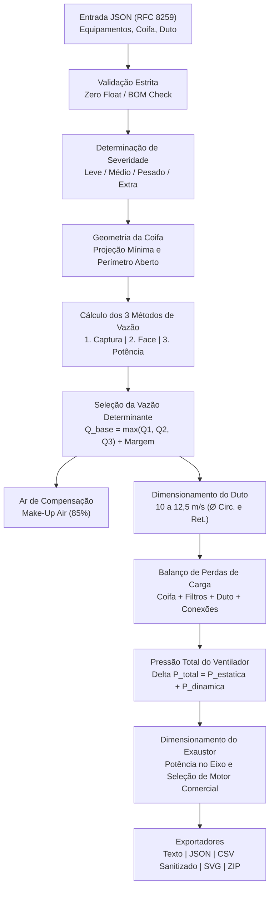
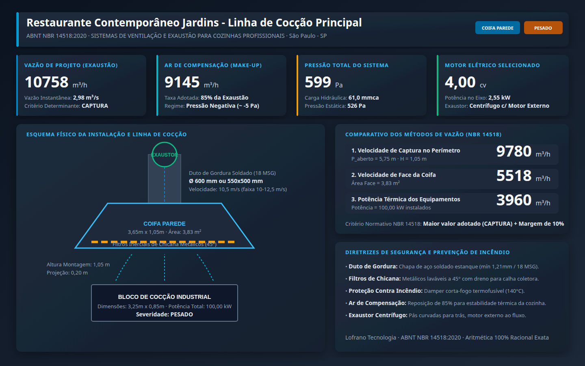

# Dimensionamento de Ventilação e Exaustão para Cozinhas Profissionais (ABNT NBR 14518:2020)

[](https://github.com/martinlofranodeoliveira/dimensionamento-ventilacao-exaustao-nbr14518/actions/workflows/ci.yml)
[](https://www.python.org/)
[](https://opensource.org/licenses/MIT)
[](https://lofranotecnologia.com.br)

Motor analítico, determinístico e de alta fidelidade para dimensionamento completo de sistemas de ventilação, exaustão mecânica de vapores graxos, coifas profissionais, redes de dutos de gordura e seleção de exaustores centrífugos industriais em conformidade estrita com a norma brasileira **ABNT NBR 14518:2020** (*Sistemas de ventilação para cozinhas profissionais*).

---

## 1. Destaques e Diferenciais de Engenharia

- **Conformidade Normativa Integral**: Implementação analítica das diretrizes da ABNT NBR 14518:2020, abrangendo classificação de severidade de cocção, os três métodos normativos de cálculo de vazão, taxa de ar de compensação (*make-up air*), velocidades de arrasto em dutos de gordura e segurança contra incêndio.
- **Aritmética Racional Exata (Zero Float)**: Todo o núcleo termodinâmico, cinemático e mecânico opera 100% sobre `fractions.Fraction` e inteiros, eliminando imprecisões e erros cumulativos de ponto flutuante IEEE-754.
- **Três Métodos de Vazão Simultâneos**:
  1. *Método da Velocidade de Captura no Perímetro Livre* ($Q_{\text{captura}}$);
  2. *Método da Velocidade de Face da Coifa* ($Q_{\text{face}}$);
  3. *Método da Potência Térmica Instalada dos Equipamentos* ($Q_{\text{termica}}$);
  - Adota o maior valor como vazão base acrescida da margem de projeto.
- **Ar de Compensação Integrado (*Make-up Air*)**: Cálculo da taxa de reposição de ar (80% a 90%) para manter leve pressão negativa na cozinha (~ -5 Pa) e prevenir refluxo de fumaça e odores para o salão.
- **Dimensionamento de Dutos de Gordura**: Cálculo de diâmetro equivalente circular e seção retangular ótima garantindo velocidade normativa entre $10{,}0\text{ m/s}$ e $12{,}5\text{ m/s}$ (prevenção de decantação de gordura líquida inflamável).
- **Balanço de Pressões e Seleção de Motores**: Avaliação de perda estática em coifa, filtros inerciais de chicana, filtros eletrostáticos, filtros de carvão, perdas distribuídas e singulares (curvas, dampers corta-fogo, saída externa) e seleção direta de motores comerciais padronizados (cv).
- **Auditoria Independente Integrada**: Verificador SQLite em memória (`tools/verify_independent.py`) que valida 100% dos cálculos sem importar os módulos de produção.
- **Garantias de Segurança**: Codec JSON estrito RFC 8259 com rejeição de BOM, floats e chaves duplicadas; CSV sanitizado contra injeção de fórmulas (CWE-1236); pacote ZIP com garantia `O_EXCL` e timestamp determinístico.

---

## 2. Diagrama de Fluxo e Arquitetura



---

## 3. Fundamentação Teórica e Formulações Normativas

### 3.1 Classificação de Severidade dos Equipamentos de Cocção (Tabela 1 - NBR 14518)

| Severidade | Equipamentos Típicos | $V_{\text{cap}}$ Parede (m/s) | $V_{\text{cap}}$ Ilha (m/s) | $V_{\text{face}}$ Parede (m/s) | $V_{\text{face}}$ Ilha (m/s) | Vazão p/ kW ($m^3/h\cdot kW$) |
|:---|:---|:---:|:---:|:---:|:---:|:---:|
| **Leve** | Fornos elétricos, banho-maria, estufas térmicas, marmiteiros | 0,25 | 0,35 | 0,25 | 0,35 | 25 |
| **Médio** | Fogões industriais abertos, chapas, fritadeiras até 15 kW, fornos combinados | 0,35 | 0,45 | 0,30 | 0,40 | 35 |
| **Pesado** | Charbroilers, fritadeiras >15 kW alta recuperação, grelhas, Wok | 0,45 | 0,55 | 0,40 | 0,50 | 45 |
| **Extra-pesado** | Equipamentos a lenha/carvão, parrilhas, churrasqueiras, forno de pizza | 0,60 | 0,70 | 0,50 | 0,60 | 60 |

### 3.2 Métodos de Cálculo de Vazão de Exaustão

1. **Método da Velocidade de Captura no Perímetro Livre**:
   $$Q_{\text{captura}} = P_{\text{aberto}} \cdot H_{\text{montagem}} \cdot V_{\text{cap}} \cdot 3600 \quad [\text{m}^3/\text{h}]$$
   Onde $P_{\text{aberto}}$ é o perímetro não encostado em paredes e $H_{\text{montagem}}$ é a distância livre vertical entre os equipamentos e a coifa.

2. **Método da Velocidade de Face da Coifa**:
   $$A_{\text{coifa}} = L_{\text{coifa}} \cdot W_{\text{coifa}} \quad [\text{m}^2]$$
   $$Q_{\text{face}} = A_{\text{coifa}} \cdot V_{\text{face}} \cdot 3600 \quad [\text{m}^3/\text{h}]$$

3. **Método da Potência Térmica Instalada**:
   $$Q_{\text{termica}} = \sum_{i=1}^{n} \left( P_i \cdot q_{\text{pot}, i} \right) \quad [\text{m}^3/\text{h}]$$

4. **Vazão de Projeto**:
   $$Q_{\text{projeto}} = \max(Q_{\text{captura}}, Q_{\text{face}}, Q_{\text{termica}}) \cdot (1 + \text{Margem})$$

### 3.3 Duto de Gordura e Balanço de Pressões

- **Velocidade Normativa no Duto**:
  $$10{,}0\text{ m/s} \le V_{\text{duto}} \le 12{,}5\text{ m/s}$$
- **Pressão Estática Total**:
  $$\Delta P_{\text{est}} = \Delta P_{\text{coifa}} + \Delta P_{\text{filtros}} + \Delta P_{\text{dist}} + \Delta P_{\text{sing}} \quad [\text{Pa}]$$
- **Pressão Dinâmica**:
  $$P_{\text{din}} = \frac{\rho \cdot V^2}{2} = \frac{1{,}2 \cdot 11^2}{2} = 72{,}6\text{ Pa}$$
- **Potência do Motor do Exaustor Centrífugo**:
  $$P_{\text{eixo, kW}} = \frac{Q_{\text{m}^3/\text{s}} \cdot \Delta P_{\text{total}}}{1000 \cdot \eta_{\text{exaustor}}}$$
  $$P_{\text{motor, cv}} = \frac{P_{\text{eixo, kW}}}{0{,}7355} \cdot 1{,}15$$

---

## 4. Instalação

O projeto requer **Python 3.11+** e utiliza exclusivamente a biblioteca padrão (zero dependências externas).

```bash
git clone https://github.com/martinlofranodeoliveira/dimensionamento-ventilacao-exaustao-nbr14518.git
cd dimensionamento-ventilacao-exaustao-nbr14518
python3 -m pip install .
```

---

## 5. Uso da Linha de Comando (CLI)

```bash
# Exibir versão instalada
nbr14518 --versao

# Exibir catálogo e tabelas normativas da NBR 14518
nbr14518 catalogo

# Gerar arquivo de exemplo JSON para edição
nbr14518 gerar-exemplo --saida meu_projeto.json

# Executar dimensionamento com saída em texto técnico
nbr14518 calcular examples/restaurante_a_la_carte_pesado.json

# Executar e gerar saída JSON canônica
nbr14518 calcular examples/restaurante_a_la_carte_pesado.json --formato json

# Executar e exportar planilha CSV sanitizada
nbr14518 calcular examples/restaurante_a_la_carte_pesado.json --formato csv --saida relatorio.csv

# Gerar pacote determinístico ZIP com relatório, CSV, JSON e painel SVG
nbr14518 calcular examples/restaurante_a_la_carte_pesado.json --pacote-zip pacote_completo.zip
```

---

## 6. Painel Infográfico de Exemplo

O motor gera um painel vetorial completo de 1440x900 pixels com o esquema isométrico da coifa, rede de dutos, exaustor e balanço termodinâmico consolidado:



---

## 7. Suíte de Testes e Auditoria

```bash
# Executar suíte completa com 52 testes unitários nativos
python3 -m unittest discover -s tests -p "test_*.py" -v

# Executar auditor independente em SQLite em memória
python3 tools/verify_independent.py
```

---

## 8. Licença

Distribuído sob licença MIT. Consulte [LICENSE](LICENSE) para mais detalhes.

Copyright (c) 2026 **Lofrano Tecnologia**.
